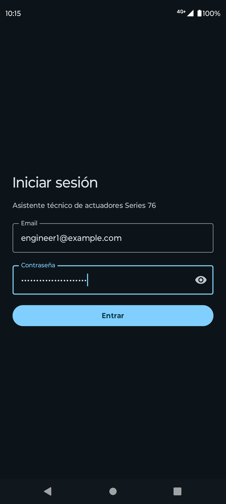
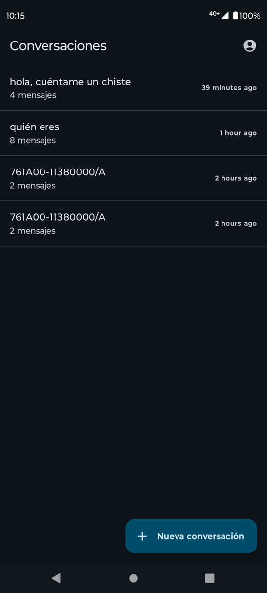
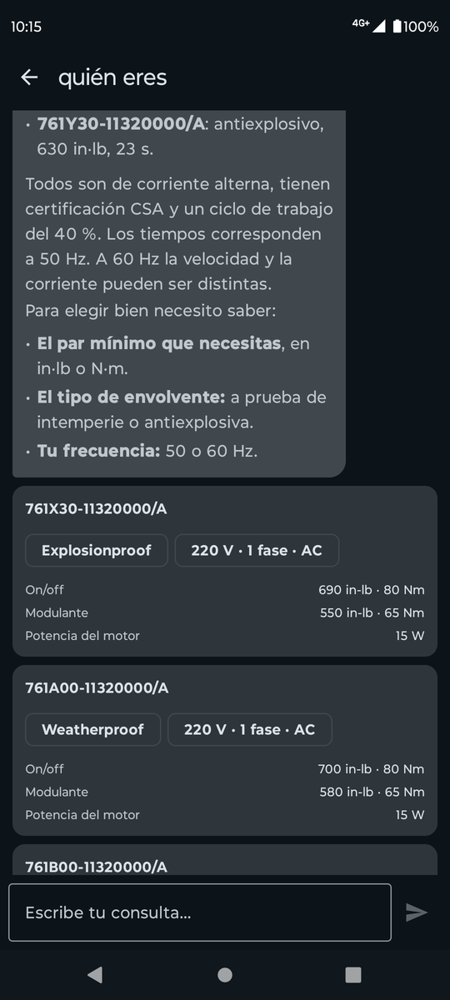
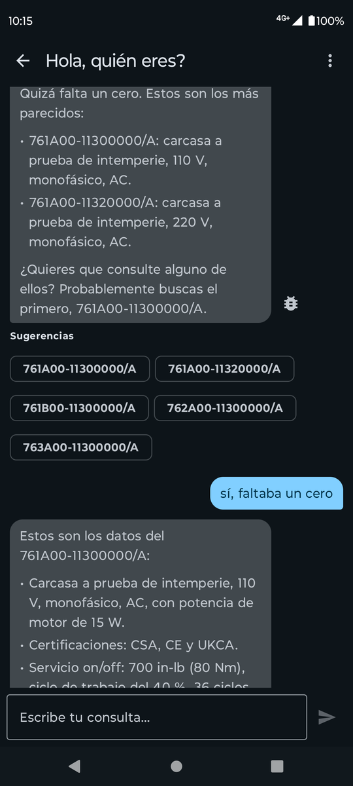
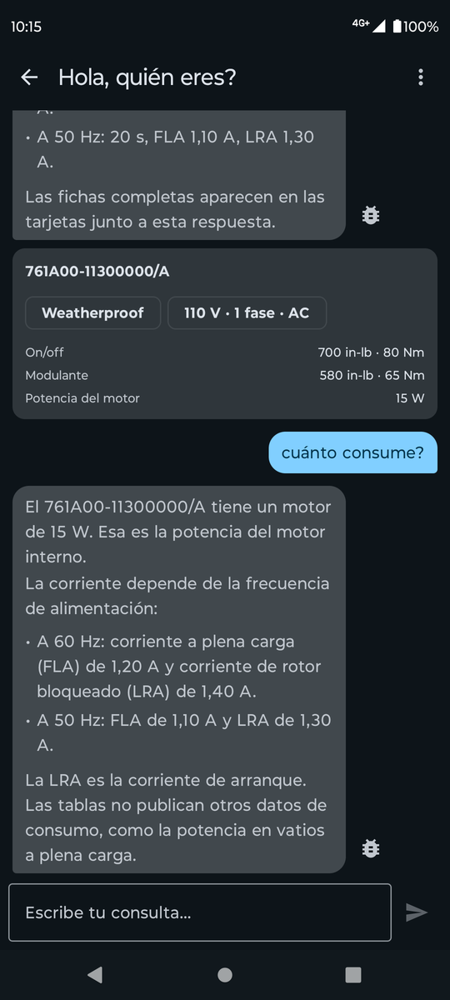
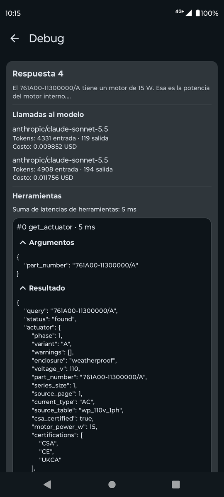
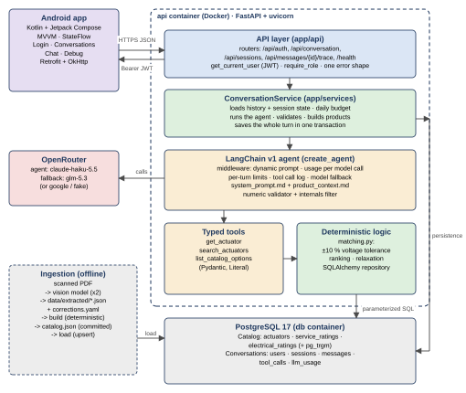

# Series 76 Technical Assistant

A technical assistant that helps plant engineers look up and select **Series 76 electric
actuators**. Users ask in natural language (for example, "I need a weatherproof modulating
actuator at 220 V") and get answers backed by the published catalog tables.

Stack: Python 3.12 · FastAPI · LangChain v1 (`create_agent`) · PostgreSQL 17 · Docker Compose ·
Android (Kotlin + Jetpack Compose).

```
backend/    FastAPI app, agent, tools, ingestion, data, tests, eval
android/    Kotlin + Jetpack Compose app
docs/       design.md and architecture decision records (adr/)
.claude/    Claude Code setup used to build the project (settings, reviewer agent, skills)
```

## Setup

Requirements:

- Docker with Compose (runs Postgres and the API).
- Android Studio with an emulator or a USB device, for the app.
- For local development, tests and ingestion: [uv](https://docs.astral.sh/uv/) (it installs
  Python 3.12) and `make`.

### Run with the real agent

> **Without a `.env` the API runs the fake model** (`LLM_PROVIDER=fake`): a scripted stand-in
> that calls the real tools but does not understand free text. It exists for tests. To try the
> assistant, configure a real model as below.

1. Create `.env` from the example:

   ```bash
   cp .env.example .env
   ```

2. Set these four variables in `.env` (the models used in the evaluation below):

   ```dotenv
   LLM_PROVIDER=openrouter
   AGENT_MODEL=anthropic/claude-haiku-5.5
   FALLBACK_MODEL=z-ai/glm-5.3
   OPENROUTER_API_KEY=<your OpenRouter key>
   ```

   Optional: `DAILY_BUDGET_USD=1` stops the API from calling the model once the day's reported
   spend reaches that amount. A chat turn costs about $0.001 with these models.

3. Start (or restart) the stack. `--build` is only needed after a code change, but is harmless:

   ```bash
   docker compose up --build -d
   ```

4. Check that the API picked up the provider:

   ```bash
   curl -s localhost:8000/health
   # {"status":"ok","database":"ok","llm_provider":"openrouter","agent_model":"anthropic/claude-haiku-5.5",...}
   ```

   If it still says `fake`, the `.env` is not in the repository root or the container was not
   recreated: run `docker compose up -d api` again.

To switch provider later, edit `.env` and run `docker compose up -d api` (no rebuild needed).
`LLM_PROVIDER=google` with a Gemini model and `GOOGLE_API_KEY` is a free alternative for manual
checks, with a low daily request limit. Model IDs are never hardcoded; they always come from
these variables.

### Environment variables

| Variable | Default | Meaning |
| --- | --- | --- |
| `POSTGRES_USER` / `POSTGRES_PASSWORD` / `POSTGRES_DB` | `series76` | Database created by compose |
| `DATABASE_URL` | local Postgres | Async SQLAlchemy URL (compose points it at the `db` service) |
| `LLM_PROVIDER` | `fake` | `fake` (no cost), `google` (free manual checks, uses `GOOGLE_API_KEY`) or `openrouter` (final validation, uses `OPENROUTER_API_KEY`) |
| `AGENT_MODEL` / `FALLBACK_MODEL` | none | Model IDs as the provider names them; required for `google`/`openrouter` |
| `OPENROUTER_API_KEY` | none | Key for `LLM_PROVIDER=openrouter` |
| `LLM_MAX_TOKENS` | `1500` | Output cap per model call; temperature is always 0 ([ADR 0005](docs/adr/0005-output-token-cap.md)) |
| `LLM_TIMEOUT_S` | `60` | Provider request timeout |
| `MODEL_CALL_LIMIT` / `TOOL_CALL_LIMIT` | `6` / `6` | Calls allowed per chat turn |
| `HISTORY_TURNS` | `10` | Earlier turns sent to the model |
| `MAX_QUERY_CHARS` | `1000` | Longest accepted query |
| `DAILY_BUDGET_USD` | none (no cap) | Daily LLM spend cap (UTC day, from the cost the provider reports); over it a turn answers 503 `budget_exceeded` without calling the model |
| `JWT_SECRET` | none in code (compose has a dev-only default) | Signs the access tokens (HS256); at least 32 characters or the API does not start |
| `JWT_EXPIRE_MINUTES` | `30` | Access token lifetime |
| `LOGIN_MAX_ATTEMPTS` / `LOGIN_WINDOW_MINUTES` | `5` / `15` | Failed logins allowed per IP and email in the window, then 429 |
| `SEED_ENGINEER1_PASSWORD` / `SEED_ENGINEER2_PASSWORD` / `SEED_DEVELOPER_PASSWORD` | none in code (compose has dev defaults) | Passwords of the demo users, used only when the seed creates them |
| `INGEST_LLM_PROVIDER` / `INGEST_LLM_MODEL` | `google` / none | Vision model for the human-run `extract` stage |
| `GOOGLE_API_KEY` | none | Google AI Studio key (`LLM_PROVIDER=google` and `INGEST_LLM_PROVIDER=google`) |
| `INGEST_OPENROUTER_API_KEY` | none | Separate OpenRouter key for `extract` only, never the agent's key |
| `EVAL_API_URL` / `EVAL_EMAIL` / `EVAL_PASSWORD` / `EVAL_TIMEOUT_S` | commented out | Evaluation runner settings (see [Evaluation](#evaluation)) |
| `LANGSMITH_TRACING` / `LANGSMITH_API_KEY` | commented out | Optional: log evaluation runs as LangSmith experiments |

## Backend

```bash
docker compose up --build   # or: make up
```

This starts Postgres and the API. On every start the `api` container runs `alembic upgrade
head`, loads `backend/data/processed/catalog.json` (an idempotent upsert; no LLM involved),
creates the demo users if they are missing (`python -m app.db.seed`) and starts uvicorn.

- API: `http://localhost:8000` (interactive docs at `http://localhost:8000/docs`)
- From the Android emulator: `http://10.0.2.2:8000`
- Health check: `curl localhost:8000/health` (database status and configured provider/models)

Compose takes `LLM_PROVIDER` from `.env`. To be sure no paid provider answers, start it with
`LLM_PROVIDER=fake docker compose up`.

Every `/api/*` route except login needs a token. Log in with one of the demo users
([Optional features](#optional-features)):

```bash
# Log in (the token lasts JWT_EXPIRE_MINUTES, 30 by default)
TOKEN=$(curl -s -X POST localhost:8000/api/auth/login \
  -H 'Content-Type: application/json' \
  -d '{"email": "engineer1@example.com", "password": "engineer1-dev-password"}' \
  | python -c "import sys, json; print(json.load(sys.stdin)['access_token'])")

# New conversation (no session_id)
curl -s -X POST localhost:8000/api/conversation \
  -H "Authorization: Bearer $TOKEN" -H 'Content-Type: application/json' \
  -d '{"query": "datos del 761A00-11300000/A"}'

# Follow-up: reuse the session_id from the previous response
curl -s -X POST localhost:8000/api/conversation \
  -H "Authorization: Bearer $TOKEN" -H 'Content-Type: application/json' \
  -d '{"session_id": "<session_id>", "query": "and how much power does it draw?"}'

# Conversations of the current user, and the history of one
curl -s localhost:8000/api/sessions -H "Authorization: Bearer $TOKEN"
curl -s localhost:8000/api/sessions/<session_id>/messages -H "Authorization: Bearer $TOKEN"
```

The response always has `session_id`, `message_id`, `answer` and `response_type` (`detail`,
`recommendation`, `comparison`, `clarification`, `no_match`, `not_found`, `no_data` or `error`),
plus `products` (the specs, built by the backend from the database), `highlight_fields`,
`clarification`, `suggestions` and `warnings`. Errors use `{"error": {"code": ..., "message":
...}}`; auth errors are 401 (`invalid_credentials`, `not_authenticated`, `invalid_token`,
`token_expired`), 403 (`forbidden`) and 429 (`too_many_attempts`).

| Method | Path | Auth | Use |
| --- | --- | --- | --- |
| POST | `/api/auth/login` | public | `{email, password}` → `{access_token, token_type, user: {email, role}}` |
| GET | `/api/auth/me` | token | The current user's email and role |
| POST | `/api/conversation` | token | One chat turn (another user's `session_id` → 404) |
| GET | `/api/sessions` | token | The current user's conversations, newest first |
| GET | `/api/sessions/{id}/messages` | token | History with the products of each answer |
| DELETE | `/api/sessions/{id}` | token | Delete a conversation |
| GET | `/api/messages/{id}/trace` | developer | Tool calls, model, tokens and cost of any message |
| GET | `/health` | public | Database status and configured provider/models |

The suggested login response `{ token }` became `{ access_token, token_type, user }` so the app
learns the role (and whether to offer the Debug screen) in the same call; the trace endpoint is
an addition for that screen.

Development:

```bash
docker compose up -d db   # tests create throwaway databases on this server
make test                 # backend tests, always with the fake LLM
make lint                 # ruff check + format check
```

## Ingestion

The data PDF is a scan, so its 7 tables (68 part numbers) are read once with a vision model and
the raw output is committed; everything after that is deterministic
([ADR 0002](docs/adr/0002-vision-extraction.md)). The processed data is already in the
repository and is loaded on every `docker compose up`, so you do not need to run ingestion to
try the assistant.

```bash
make ingest   # build + load: same as the two commands below

cd backend
uv run python -m ingest.ingest build   # data/extracted + corrections.yaml -> data/processed (offline)
uv run python -m ingest.ingest load    # data/processed/catalog.json -> Postgres (idempotent upsert)

# Only when re-reading the PDF (human-run, calls a vision model). INGEST_LLM_PROVIDER=google
# needs GOOGLE_API_KEY; INGEST_LLM_PROVIDER=openrouter needs INGEST_OPENROUTER_API_KEY.
uv run --group extract --env-file ../.env python -m ingest.ingest extract
```

Where the data ends up:

| Path | Content |
| --- | --- |
| `backend/data/raw/` | Source PDFs (not edited) |
| `backend/data/extracted/` | Raw vision-model output, two runs per table, and `discrepancies.md` |
| `backend/data/corrections.yaml` | Human-reviewed fixes for cells where the two runs disagree |
| `backend/data/processed/actuators.csv`, `catalog.json` | Validated catalog generated by `build` |
| PostgreSQL | Catalog tables filled by `load` from `catalog.json` |

`extract` runs the vision model twice per table and writes the cells where the runs disagree to
`data/extracted/discrepancies.md`. Each one is checked against the PDF and fixed in
`data/corrections.yaml`; `build` refuses to run until every disagreement is covered. `build`
also validates row counts per table, N/A rows (stored as `NULL`, never `0`), CSA flags and
in-lb vs Nm consistency.

## App

Open the `android/` folder in Android Studio, let Gradle sync, and run the `app` configuration
on an emulator (or a device, see below) while the backend is up. Sign in with one of the demo
users.

```bash
cd android
./gradlew assembleDebug          # build the APK
./gradlew test                   # unit tests: API contract, repository errors, ViewModels
./gradlew connectedAndroidTest   # Compose UI tests (needs an unlocked device or emulator)
```

**Pointing the app to the backend.** By default the app calls `http://10.0.2.2:8000`, the host
machine as seen from the emulator. To use another address, set it in `android/local.properties`
(not committed) and rebuild:

```properties
API_BASE_URL=http://<host>:8000
```

Plain HTTP is allowed only for `10.0.2.2`, `localhost` and `127.0.0.1`
(`res/xml/network_security_config.xml`). On a physical device over USB, keep
`API_BASE_URL=http://localhost:8000` and forward the port with `adb reverse tcp:8000 tcp:8000`.

**Screens.** Login, Conversations (list, open, new, delete; account menu with sign out), Chat
(multi-turn, product cards built from `products`, no tool names or internals) and Debug. Every
screen handles loading and errors, each with its own message and "Retry": no connection,
timeout, server down, server error (5xx), assistant unavailable (503 `llm_unavailable`) and
daily limit reached (503 `budget_exceeded`).

**A short tour** (moto g52 over USB, real agent): sign in, pick a conversation, ask for a
recommendation (product cards rendered from `products`), mistype a part number (suggestions as
chips), follow up on it ("cuánto consume?"), and open the answer's trace as the developer.

| Login | Conversations | Recommendation |
|:-:|:-:|:-:|
|  |  |  |
| **Part number not found** | **Follow-up** | **Debug (developer)** |
|  |  |  |

**Opening the Debug screen (developer role only).** Sign in as `developer@example.com`. Each
assistant answer shows a bug icon that opens its trace, and the chat's ⋮ menu → Debug opens the
traces of the whole conversation: the tool calls in order (name, latency, arguments and result
as foldable JSON), and each model call's model, tokens and cost ("no informado" when the
provider does not report it). For an engineer neither entry exists, and a 403 from the trace
endpoint shows "No tienes permiso para ver trazas" without retrying.

**Fixtures.** The JSON payloads in `android/app/src/test/resources/` feed the tests and the
`@Preview`s. They are generated from the real API with the fake LLM, so they hold catalog values
only from the database. Regenerate them with `make android-fixtures` (needs `docker compose up -d
db`) whenever a response changes; a backend test fails while they are stale.

## Design and architecture



The tools and the deterministic logic are the only path to the catalog numbers: the agent calls
the tools, and the backend builds `products` from their typed results.

The full design (data model, API contract, agent, edge cases) is in
[`docs/design.md`](docs/design.md). The main decisions:

- **Tables as structured data, not RAG.** The catalog is 68 rows with typed fields, so it lives
  in PostgreSQL tables and is queried with exact filters. Filtering is explainable and lets the
  backend guarantee where every number comes from. No embeddings or pgvector: they would only
  help with free text, and the summary PDF fits in the prompt: it is rewritten without product
  values as `backend/app/agent/product_context.md` and sent with every model call
  ([ADR 0008](docs/adr/0008-summary-as-product-context.md)). Trade-off: questions outside the
  typed fields and the summary have no retrieval path.
- **The LLM does not filter, rank or compute.** One `create_agent` agent with three typed tools
  (`get_actuator`, `search_actuators`, `list_catalog_options`). Normalization, filtering,
  ranking, voltage tolerance and closest alternatives are deterministic Python with unit tests;
  the LLM never writes SQL. Trade-off: every new kind of question needs a tool argument, not
  just a prompt change.
- **Numbers never come from the LLM's text.** The backend builds `products` from tool results,
  and the app renders specs from it. A numeric validator checks that every number in `answer`
  exists in this session's tool results or a small allowlist.
- **Conversations live in Postgres** (sessions, messages, tool calls, LLM usage), so they survive
  a restart, and the trace is a separate developer-only endpoint so internals never reach the
  chat.
- **Auth with JWT and two roles** (engineer, developer); sessions are per user.

| ADR | Decision |
| --- | --- |
| [0001](docs/adr/0001-catalog-schema.md) | Catalog schema |
| [0002](docs/adr/0002-vision-extraction.md) | Vision extraction for a scanned data PDF |
| [0003](docs/adr/0003-tool-logic-in-python.md) | Search logic in Python over loaded rows |
| [0004](docs/adr/0004-agent-and-conversation-service.md) | Agent, conversation service and response building |
| [0005](docs/adr/0005-output-token-cap.md) | Output token cap of 1500 |
| [0006](docs/adr/0006-auth-and-roles.md) | Authentication with JWT and two roles |
| [0007](docs/adr/0007-app-session-storage.md) | App session: encrypted storage and one session state |
| [0008](docs/adr/0008-summary-as-product-context.md) | Summary PDF as product context in the prompt |

## Model choices

All models are set by environment variables; none is hardcoded. The heavy lifting is done by
code, so the agent needs reliable tool calling and good Spanish more than raw reasoning.

| Task | Variable | Model used | Why | Measured cost |
| --- | --- | --- | --- | --- |
| Agent (tool calling + answer) | `AGENT_MODEL` | `anthropic/claude-haiku-5.5` via OpenRouter | The agent's job is strict instruction following more than reasoning: pick the right tool, never write numbers that are not in a tool result, no tables, no internals, answer in the user's language. Filtering, ranking and units are code, so a small model is enough as long as it follows those rules. It was chosen by measurement: on the full eval suite it scored 100 % on every metric, as `anthropic/claude-sonnet-5.5` did in its last run, at about 17 times less per turn ($0.0012 vs $0.0202; OpenRouter list prices: $0.10 vs $2.00 per million input tokens, $0.50 vs $10.00 per million output tokens). No turn needed the validator to strip a number. At the measured cost the $10 key covers about 8,600 turns | $0.0012 per turn on average, about 9,280 tokens per turn (latest full eval) |
| Fallback when the agent model fails | `FALLBACK_MODEL` | `z-ai/glm-5.3` via OpenRouter | A different provider and model family, so an outage or rate limit at the agent model's provider does not take the assistant down. It supports tool calling and only runs when the primary fails, so availability matters more than quality or price | Not called in any eval run ($0) |
| Vision extraction of the scanned PDF (human-run, once) | `INGEST_LLM_PROVIDER`, `INGEST_LLM_MODEL` | `google/gemini-3.8-flash-20260902` via OpenRouter (recorded in `backend/data/extracted/*.json`) | Reads scanned tables well and returns structured JSON; the same family is free on Google AI Studio, so extraction can be tried without spending the key. It runs only when the PDF is re-read, and its output is committed | Not recorded: `extract` does not log usage. A run is 14 calls (7 tables, twice each) |
| Tests and local runs | `LLM_PROVIDER=fake` | `fake-rules` (scripted, calls the real tools) | No cost, deterministic | $0 |

Measured spend on the OpenRouter key:

- Evaluation runs (from `backend/eval/results/`): on 2026-11-07 with Sonnet, $0.731 (first full
  run), $0.133, $0.091 and $0.024 (targeted reruns of failing cases) and $0.809 (full run); on
  2026-11-08 with Haiku, $0.047 (full run). **$1.84 in total**.
- Manual checks recorded in the local `llm_usage` table: 7 model calls to
  `anthropic/claude-sonnet-5.5` on 2026-11-08, $0.080.
- The key's overall balance is on the OpenRouter dashboard. The repository records only the
  eval runs above and the per-message usage in `llm_usage`, and the local database holds no usage
  from before its last reset.

## Evaluation

The agent is evaluated end to end through the API. `backend/eval/generate_cases.py` builds cases
from `data/processed/catalog.json` (lookups, searches, comparisons, multi-turn chains; expected
part numbers and thresholds are computed from the catalog) and merges the hand-written edge cases
in `eval/cases_manual.jsonl` into `eval/cases.jsonl`. Twenty of them are marked `fast`.

```bash
make eval-cases   # regenerate eval/cases.jsonl
make eval-fast    # 20 fast cases against http://localhost:8000, logged in as the developer user
make eval-full    # every case with the paid provider; loads .env, passes --confirm-paid
```

`eval/run_eval.py` scores each turn on tool selection, argument accuracy, expected part numbers,
`response_type`, numeric faithfulness (every number in the answer is in a tool result),
coreference (follow-ups target the active product) and answer format (no Markdown tables: the
app shows specs from `products`), and reports p50/p95 latency and cost per turn. It prints a
table per category and writes `eval/results/<date>-<model>.json`. It refuses to run against
`openrouter` (checked locally and through `/health`) without `--confirm-paid`. With
`LANGSMITH_TRACING=true` it also uploads the dataset and logs a LangSmith experiment.

Latest full run: 2026-11-08, `anthropic/claude-haiku-5.5` via OpenRouter (fallback
`z-ai/glm-5.3`, never called), 37 cases / 41 turns
([`backend/eval/results/2026-11-08-anthropic-claude-haiku-5.5.json`](backend/eval/results/2026-11-08-anthropic-claude-haiku-5.5.json)).
It runs the current code: the part-number and internals checks of the validator and the summary
as product context. Tool selection, argument accuracy, expected part numbers, `response_type`,
numeric faithfulness, coreference and answer format all scored 100 % in every category, and no
answer had numbers stripped.

| Category | Cases passed | Turns | p50 latency | p95 latency | Cost per turn | Tokens per turn |
|---|---|---|---|---|---|---|
| detail | 10/10 | 10 | 2962 ms | 4484 ms | $0.0009 | 7980 |
| search | 6/6 | 6 | 4145 ms | 8131 ms | $0.0013 | 9575 |
| comparison | 4/4 | 4 | 4910 ms | 8981 ms | $0.0016 | 11967 |
| multi_turn | 4/4 | 8 | 3997 ms | 7629 ms | $0.0013 | 10125 |
| invalid_part | 2/2 | 2 | 3592 ms | 4898 ms | $0.0012 | 9868 |
| missing_data | 2/2 | 2 | 3369 ms | 3438 ms | $0.0009 | 7820 |
| ambiguous | 2/2 | 2 | 3237 ms | 4080 ms | $0.0010 | 8074 |
| no_match | 3/3 | 3 | 6213 ms | 6782 ms | $0.0015 | 11483 |
| certification_tolerance | 3/3 | 3 | 2172 ms | 4587 ms | $0.0009 | 8196 |
| out_of_scope | 1/1 | 1 | 1263 ms | 1263 ms | $0.0004 | 3655 |
| **Total** | **37/37** | **41** | **3974 ms** | **7629 ms** | **$0.0012** | **9277** |

Whole run: $0.047.

Earlier runs, with `anthropic/claude-sonnet-5.5` on 2026-11-07: the first full run passed 27/36
(`…-sonnet-5.5-6.json`); after the fixes in [ADR 0005](docs/adr/0005-output-token-cap.md) and
the commits that followed it, the last one passed 36/36 at $0.0202 per turn, p95 9799 ms
(`…-sonnet-5.5-11.json`). That code had neither the new validator checks nor the product
context, so the two models are compared on slightly different code.

## Optional features

**Login: implemented.** Email and password return a JWT access token; passwords are hashed with
Argon2. The app has a login screen and sends `Authorization: Bearer <token>` on every request;
the backend takes the user from the token and each user sees only their own conversations
([ADR 0006](docs/adr/0006-auth-and-roles.md)). In the app the token, email and role are stored
encrypted (DataStore + Tink, key in the Android Keystore) and excluded from backups; the
password is never stored ([ADR 0007](docs/adr/0007-app-session-storage.md)).

Test users, created by the seed on the first start:

| Email | Role | Password with the compose defaults (development only) |
| --- | --- | --- |
| `engineer1@example.com` | engineer | `engineer1-dev-password` |
| `engineer2@example.com` | engineer | `engineer2-dev-password` |
| `developer@example.com` | developer (can open the Debug screen) | `developer-dev-password` |

Set `SEED_*_PASSWORD` in `.env` before the first start to use other passwords.

**Voice messages: not implemented.**
